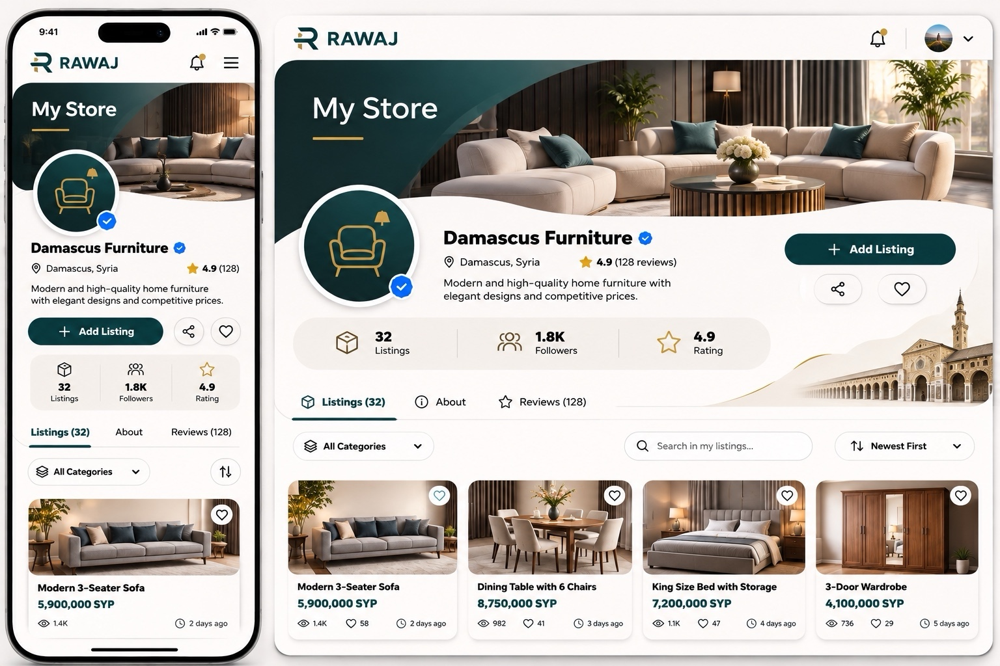

# My Store reference rebuild — review pending

This branch replaces `/profile/listings` presentation with a route-owned ivory/petrol layout. It preserves the account/listing APIs, ownership rules, lifecycle confirmations, review states, performance metrics and bulk operations. Owner controls live in contextual menus and dialogs.

## Reference

## Visual acceptance

**Pending. Do not merge or deploy.** Local Chromium could not launch because the execution environment denies a required Unix socket (`socket() failed: Operation not permitted`). Playwright's alternate browser download returned truncated archives. No local screenshot or real iPhone Safari result is claimed.

`My Store Visual Review` renders the actual route in GitHub Actions using isolated fixtures and captures 320, 390, 430, 768 and 1440 CSS-pixel widths, Arabic RTL, and missing-image state. Its artifact is named `my-store-visual-review`. Screenshots are representative fixture data, not production records. User approval is required after screenshots are inspected against the reference.

## Differences requiring visual review

- Actual store media and available statistics replace illustrative furniture branding and example counts. Missing statistics use an em dash; absent reviews/verification are not fabricated.
- The secondary heart control is an owner-options menu, and each card has a contextual action menu; owners are not given a fake self-follow/favorite action.
- Mobile search is a compact expandable control. Existing sorting semantics are labeled “Recently updated,” not falsely described as publication date.
- The decorative architectural photograph in the desktop reference is not supplied as a separate asset and has not been reproduced. The reference photograph itself is not used as a page background or screenshot façade.
- Existing application bottom navigation remains available. Exact spacing, typography and inherited shell effects remain subject to rendered verification.

## Checks

See the PR for final check results. The browser test covers tabs, search, category filter, sorting, owner controls, creation link, responsive grid, overflow, RTL and compact missing-photo state. It does not claim real iPhone Safari coverage.
